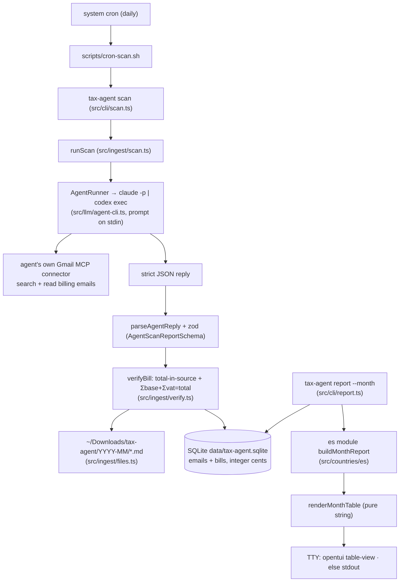

# 01 — PRD & Architecture Spec

- Status: **DRAFT — awaiting human approval** (reply `approved` or `change: 
`)
- Date: 2026-07-02
- Traces to: [`00-requirements.md`](./00-requirements.md)

## 1. Goal
A local-first personal tax agent for Spain. A daily system-cron run checks the user's Gmail for
billing emails via the user's own **subscription agent CLI** (`claude -p` / `codex exec` — its
Gmail MCP connector does the reading), saves each month's bills as Markdown under
`~/Downloads/tax-agent/YYYY-MM/`, stores classified figures in local SQLite, and
`tax-agent report` shows a monthly table (per-bill rows + Spain summary from the `es` module).
Dominant constraint: **tax-figure correctness and auditability** — every rendered number traces to
a bill id or a cited rule, mechanically enforced.

## 2. Non-goals
No Google API / OAuth / API keys (user directive: subscription CLIs only) · no original PDF
attachment downloads in v1 (the Gmail MCP connector has no attachment tool — extracted Markdown +
an `adjunto pendiente` flag instead) · no income ingestion, so NO full Modelo 303/130 liability —
figures are expense-side estimates, labeled as such · no sqlite-vec/RAG yet · no OCR · no filing ·
no interactive month navigation · no in-process scheduler (system cron only).

## 3. Architecture

## 4. Components
- `src/cli/` — argv router (`args.ts`, pure) + one thin shell per command (`interview`, `scan`,
  `report`); shells are coverage-excluded, logic lives below.
- `src/domain/` — zod boundaries: `profile.ts` (A1), `bill.ts` (agent JSON contract, printed-amount
  parsing, stored `BillRecord`), `agent.ts` (`AgentRunner` seam).
- `src/llm/agent-cli.ts` — subscription-CLI adapter (execFile, stdin prompt, provider matrix
  claude/codex, env-selected). The ONLY LLM touchpoint; no SDKs, no keys.
- `src/ingest/` — `scan-task.ts` (prompt + reply parsing + retry prompt), `verify.ts`
  (never-fabricate gate), `files.ts` (bill Markdown writer), `scan.ts` (orchestration).
- `src/countries/` — per-country boundary. `types.ts` (`TraceableFigure`: unconstructible without
  sources), `registry.ts`, `es/` (cited rules, pure report math, golden fixtures).
- `src/report/render-month-table.ts` — pure string renderer. `src/tui/table-view.ts` — opentui
  keep-alive display (q/Esc exits).
- `src/storage/` — `migrations.ts` (user_version), `db.ts`, `profile-repo.ts`, `ingest-repo.ts`
  (prepared-once statements, transactions).
- Deliberately NOT abstracted: no mail-source interface (the agent CLI is the only source), no
  report-format interface (string is the format), registry is a one-key literal.

## 5. Data model
- `profile(id, data JSON, updated_at)` — A1, unchanged.
- `emails(id, gmail_message_id UNIQUE, received_date, status CHECK
  billed|attachment_pending|not_a_bill|failed, error_code, created_at)` — idempotency anchor.
- `bills(id, email_id UNIQUE FK, vendor, issue_date NULL, currency, total_cents INTEGER CHECK ≥0,
  vat_lines JSON zod-validated, category, file_path, source_quote, extractor, verified, extracted_at)`
  + index on issue_date. Invariants: money is ALWAYS integer cents; one bill per email
  (ponytail ceiling); provenance chain bill → email.gmail_message_id + file_path + source_quote.
- Migrations: `PRAGMA user_version` + append-only SQL array; v1 adopts the legacy A1 DB.

## 6. Interfaces / API
- CLI: `tax-agent [interview|scan|report [--month YYYY-MM]|help]` — validated by
  `parseCliArgs` (`src/cli/args.ts`, `MonthSchema`).
- Agent contract: `AgentScanReportSchema` (`src/domain/bill.ts`) — `{bills[], attachmentOnly[],
  notBills[], hasMore}`; amounts as printed strings, converted by `parsePrintedAmountCents`.
- Country: `CountryModule.buildMonthReport({bills, profile, month}) → CountryReport{figures:
  TraceableFigure[], notes}` (`src/countries/types.ts`).
- Env: `TAX_AGENT_LLM` (claude|codex), `TAX_AGENT_LLM_MODEL`, `TAX_AGENT_LLM_EFFORT`,
  `TAX_AGENT_LLM_BIN`, `TAX_AGENT_DOWNLOADS_DIR` — all zod-validated at the boundary.

## 7. Key decisions & algorithms
- **Subscription CLI over Gmail API** (user directive): reuses claude/codex subscriptions; the
  headless claude session reaches the user-level Gmail connector (`claude mcp list` verified).
- **Never-fabricate gate is mechanical**: extracted total (in cents) must appear among
  `normalizeAmountTokens(sourceQuote+body)` (both es/en separator readings); Σbase+Σvat=total
  ±1c/line; else the bill is rejected and only a `failed` email row is stored.
- **Amounts as printed strings**: the model copies, code converts (`parsePrintedAmountCents`) —
  no model arithmetic, no floats anywhere.
- **TraceableFigure** throws on empty sources — the "no number without a source" hard rule is a
  type-level/runtime invariant, not a review checklist item.
- Watermark = `MAX(received_date)` − 2 days; `gmail_message_id UNIQUE` makes overlap free.
- Report renders in the TUI on a TTY (explicit user request) and prints the identical string on
  stdout otherwise (cron/pipes).

## 8. Observability
`data/logs/cron.log` (gitignored, 0700 dir). Scan logs counts, gmail message ids, reason codes,
durations — NEVER subjects/vendors/amounts/prompts. Exit codes: 0 clean · 2 partial failures ·
1 fatal (cron MAILTO-able).

## 9. Security
PII stays on device: bills/DB under `data/` (0700/0600) and `~/Downloads/tax-agent` (0700/0600);
only email content the user's OWN agent CLI reads leaves through that CLI's channel (same trust as
using claude/codex directly). No API keys anywhere. execFile without shell; prompts via stdin (not
argv/ps). Errors carry codes, never content. Trust boundary (honest): sourceQuote/body come from
the same agent session — arithmetic + containment checks bound fabrication but cannot fully prove
provenance without original documents (recorded nice-to-have).

## 10. Assumptions & tradeoffs
Headless `claude -p` reaches the user-level claude.ai Gmail connector (verified non-interactively;
re-proven in B7 E2E). codex parity requires the user to configure a Gmail MCP for codex. macOS TCC:
cron needs a one-time Full Disk Access grant to write `~/Downloads` (fallback:
`TAX_AGENT_DOWNLOADS_DIR=data/bills`). cron wrapper pins the nvm node path (bump on node upgrades).
Extracted Markdown instead of original PDFs is a deliberate v1 trade (connector limitation).

## 11. Open questions
- `DEDUCTIBLE_SHARE` legal accuracy (prorrata for utilities/rent) — user/asesor review of
  `src/countries/es/rules.ts`.
- Accept the cron Full Disk Access grant, or default to `data/bills/`?
