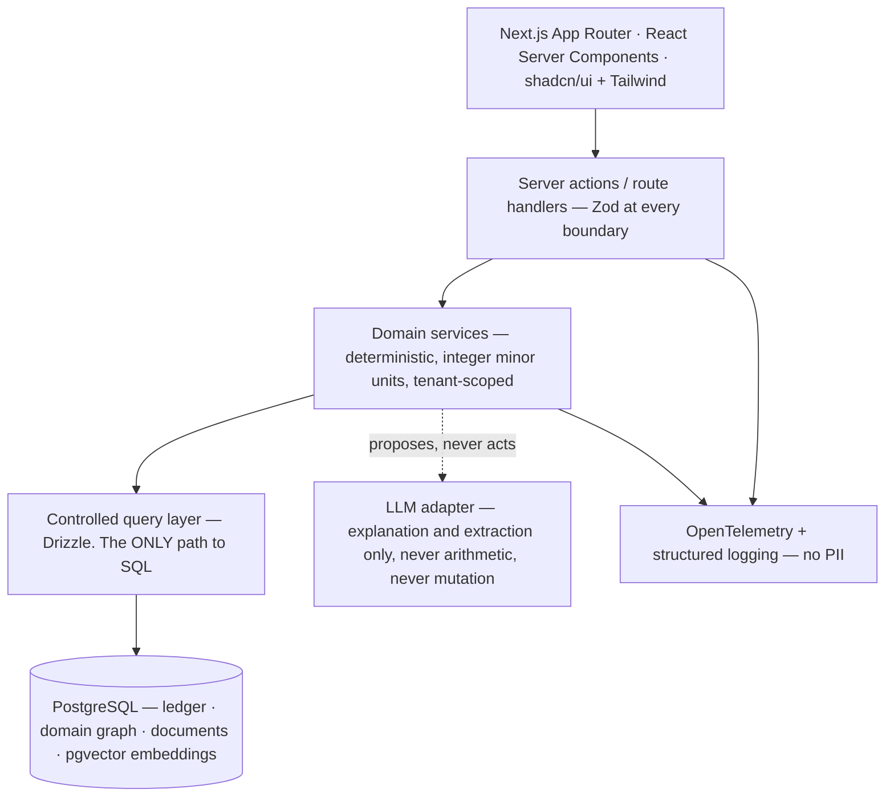

# 01 — Architecture Spec

- Status: **TARGET ARCHITECTURE — not implemented.** Records the decisions the contract already
  fixes. Detailed component and schema design is Phase 1 work and is explicitly marked below.
- Date: 2026-08-02
- Traces to: [`00-requirements.md`](./00-requirements.md)
- Decisions: [ADR 0001](../../docs/adr/0001-graph-orchestrated-loop-pipeline.md) ·
  [0002](../../docs/adr/0002-graph-source-of-truth-separation.md) ·
  [0003](../../docs/adr/0003-herdr-orchestration-boundary.md) ·
  [0004](../../docs/adr/0004-postgresql-19-version-posture.md)

> **P0 scope note.** This document records architecture that is *decided*, not architecture that is
> *built*. No application code, schema, migration, or UI exists. Anything not yet decided is marked
> **[Phase 1]** rather than invented here — a spec that guesses is worse than a spec that admits a
> gap.

## 1. Goal

A multi-user, multi-household financial intelligence platform. Deterministic accounting over
append-only facts, explained by a financial domain graph, evidenced by ingested documents, and
surfaced through auditable recommendations that a human approves before anything happens.

Dominant constraint: **financial correctness and auditability** — every figure traces to a source
document or a cited rule, mechanically enforced rather than review-enforced.

## 2. Non-goals

No autonomous financial action (the system recommends; a human acts) · no direct filing or
submission to a tax authority · no dedicated graph database or external vector database in the
initial phases · no LLM-generated SQL outside a controlled query layer · no production use of
prerelease database software without explicit human approval · no single-tenant shortcuts.

## 3. The four graphs and the ledger

The structural core of the system (ADR 0002). Authority is the load-bearing column:

| Layer | Role | Authority |
|---|---|---|
| **Ledger** | append-only financial facts | **the source of financial truth** |
| **Financial domain graph** | relationships, dependencies, blockers, enablers, exposure, provenance, explanations | normative for *why*, never for *how much*. **Never replaces the ledger** |
| **RAG (documents + embeddings)** | documentary evidence, historical context | evidentiary only. **Never authoritative for current balances** |
| **Task execution graph** | delivery planning (`.ai/specs/task-graphs/`) | build-time only, not a runtime concern |
| **Evidence graph** | requirement → behavior → implementation → test → passing output | normative for "is it done" |

A balance is always read from the ledger. A domain-graph node references a ledger entity by **id**,
never by denormalized amount. A retrieved document may be cited as provenance; it may not answer
"what is my balance".

## 4. Layers

**Rule:** no layer skips the controlled query layer. LLM-generated SQL never reaches PostgreSQL.

## 5. Multi-tenancy

- Every domain row is owned by a tenant (user → household → member).
- **Every read and write carries an explicit authorization filter in the query**, not in
  application logic that "always passes the right id".
- Isolation is proven by **negative** tests: household B must be refused A's rows, including via
  shared institutions.
- **[Phase 1]** Enforcement mechanism — application-level scoping vs PostgreSQL row-level security —
  is undecided and requires an ADR with evidence.

## 6. Money

- Integer **minor units** end to end. No floating-point path exists anywhere, including
  serialization.
- Every monetary value carries an explicit **currency**.
- Every value carries a **classification**: actual · planned · forecast · simulated · recommended.
  The tag survives every transformation.
- Rounding is applied **exactly once**, at a named boundary.
- Precedent in the repository today: `src/countries/es/report.ts` — integer cents, one `Math.round`
  per bill, provenance carried alongside. Phase 1 ports this model rather than reinventing it.

## 7. Jurisdictions

Jurisdiction rules live behind a per-jurisdiction module so a second jurisdiction is **additive**
and shared code contains no jurisdiction conditionals. Rules are **cited**: a computed figure names
the rule id it came from, and a rule with no citation cannot produce a figure.

Legacy precedent: `src/countries/{types,registry}.ts` with `TraceableFigure` — a figure type that
cannot be constructed without sources. Phase 1 ports this invariant.

## 8. Retrieval

- **pgvector** stores embeddings. No separate vector database.
- Lexical retrieval uses PostgreSQL. **It must not be called BM25 unless it is BM25** — the concrete
  implementation must be identified, benchmarked, and recorded in an ADR **before** retrieval
  production code begins.
- Results are combined by **reciprocal-rank fusion**.
- Retrieval serves evidence and context. It never answers a balance question.

## 9. Loops

Financial loops are closed: recommendation → human approval → action → observed outcome →
reconciliation → next plan. A loop whose outcome feeds nothing is **open**, and must be described as
open rather than implying feedback. State machines, retry, resume, idempotency, and compensation
follow `financial-loop-engineering` and `.ai/references/loop-state-machines.md`.

The system may compute, rank, explain, and stage. **It may not act.**

## 10. Observability and security

- OpenTelemetry traces + structured logs. **No PII, ever** — no amounts, vendors, or document
  content in logs; ids and reason codes only.
- Secrets from the environment; none in source. Validated at startup.
- Zod at every external boundary.
- Documents and derived data are tenant-scoped at rest.
- **[Phase 1]** Authentication and session model — undecided; requires an ADR.
- **[Phase 1]** Document storage location and encryption at rest — undecided.

## 11. Delivery

Pipeline V2 (`.ai/pipeline.md`): `/map → /spec → /plan → /build → /reconcile → /test →
/consensus-review → /code-simplify → /ship → /acceptance → /goal → /evolve`. Task graphs are
committed under `.ai/specs/task-graphs/` and validated by `scripts/validate-task-graph.mjs`.

Gates (Definition of Done, `.ai/context.md`): `pnpm test` (≥80%, blocking pre-commit) ·
`pnpm exec tsc --noEmit` · `pnpm exec biome check` · task-graph validation ·
`sh scripts/sync-ai-docs.sh` drift gate.

## 12. Open questions

- Lexical ranking implementation for hybrid retrieval — must be benchmarked and ADR'd before
  retrieval code (see §8).
- Tenancy enforcement mechanism (§5).
- Authentication/session model and document-at-rest encryption (§10).
- Migration path and retirement criteria for Legacy v0 (Appendix A).

---

## Appendix A — Legacy CLI (v0) architecture · shipped, frozen

Preserved because it is running code, and because two of its invariants are the precedent the
platform inherits. **Not the target architecture. Do not extend it.**

**What it is:** a single-user, Spain-only, local-first CLI. Node 22 · pnpm · better-sqlite3 ·
opentui · Zod · Vitest · Biome. A daily system-cron run invokes the user's own subscription agent
CLI (`claude -p` / `codex exec`, whose Gmail MCP connector reads billing email), writes each month's
bills as Markdown, stores classified figures in local SQLite, and `report` renders a monthly table.

**Components:** `src/cli/` (argv router + one thin shell per command) · `src/domain/` (Zod
boundaries: `profile`, `bill`, `agent` seam) · `src/llm/agent-cli.ts` (the only LLM touchpoint —
execFile, prompt on stdin, no SDKs, no keys) · `src/ingest/` (prompt, reply parsing, never-fabricate
gate, file writer, orchestration) · `src/countries/` (per-country boundary; `TraceableFigure`;
`es/` cited rules + golden fixtures) · `src/report/` (pure string renderer) · `src/storage/`
(`user_version` migrations, repos with prepared statements).

**Data model:** `profile(id, data JSON, updated_at)` · `emails(id, gmail_message_id UNIQUE,
received_date, status, error_code, created_at)` · `bills(id, email_id UNIQUE FK, vendor, issue_date,
currency, total_cents INTEGER, vat_lines JSON, category, file_path, source_quote, extractor,
verified, extracted_at)`. Money is always integer cents; provenance chains bill → email id +
file_path + source_quote.

**The two invariants the platform inherits:**

1. **Never-fabricate is mechanical, not a checklist.** The extracted total must appear among the
   normalized amount tokens of the source text (both es/en separator readings), and
   Σbase + Σvat = total (±1c per line). Otherwise the bill is rejected. Amounts are copied by the
   model as printed **strings** and converted by code (`parsePrintedAmountCents`) — no model
   arithmetic, no floats.
2. **`TraceableFigure` throws on empty sources.** "No number without a source" is a runtime
   invariant, not a review item.

**Known limitations at freeze:** expense-side estimates only (no income ingestion, so no full
Modelo 303/130 liability) · extracted Markdown rather than original PDFs for some sources · no
sqlite-vec/RAG · no OCR · no filing · single user. Provenance is bounded by the fact that
`sourceQuote` and body come from the same agent session — arithmetic and containment checks bound
fabrication but cannot fully prove provenance without original documents.

**Open legacy question carried forward:** `DEDUCTIBLE_SHARE` legal accuracy (prorrata for
utilities/rent) in `src/countries/es/rules.ts` needs asesor review before those rules are ported.
